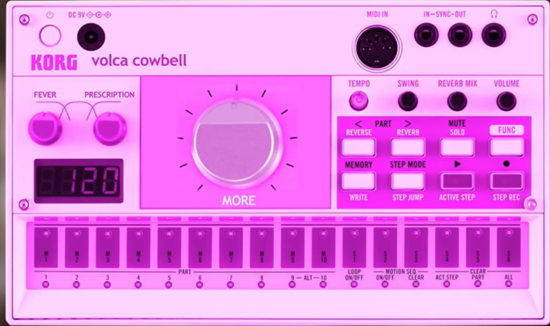
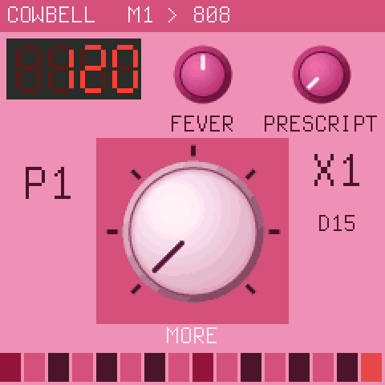
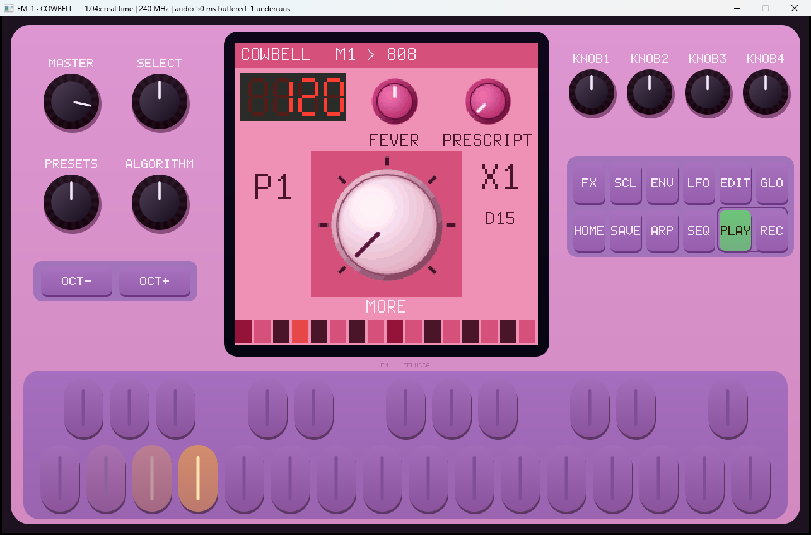

# fm1-cowbell
Remember that time when Bad Gear asked Korg to make a Volca Cowbell way back in 2023?  

Korg was too scared of it's awesomeness, so now that the FM-1 supports custom firmware, I decided to take it into my own hands and create an FM-1 Firmware modeled after the meme! 

Cowbell features the giant more knob for ratchets, fever, which controls pitch, and prescription which selects one of 13 presets. The presets are recorded from a Roland TR-83 and Alesis DM-10 module to provide a variety of cowbell sounds. 

The firmware only comes with 22 KHz sample sounds, but you can use the sample uploader to get better quality samples.  

## What it looks like

COWBELL playing its first pattern in the fm1-emu emulator, skinned as a pink FM-1:

## Install

Download `COWBELL.fwsc` from the [latest release](https://github.com/C0DED00D/fm1-cowbell/releases/latest) and
install it like any fm1_open firmware: see [fw/README.md](fw/README.md#install). COWBELL starts playing right away
on its built-in samples; then send the full-quality ones with the sample uploader below.

## Sample uploader

**https://c0ded00d.github.io/fm1-cowbell/**

The uploader page sends the full-quality set (44.1 kHz, 143 KB) to the FM-1 over USB-MIDI from the
browser (Chrome or Edge). The samples stay through power-offs and firmware updates.

In order to use it:
1. Plug the FM-1 in over USB with COWBELL running, and close other programs that use its MIDI port.
2. Open the page, press **Connect to the FM-1**, allow MIDI access.
3. Press **Send to the FM-1** (about ten seconds).

The page and the sample bank are in [`docs/`](docs/).

## Build it yourself

The firmware's source is in [`cowbell/`](cowbell/) (the synth) and [`fw/`](fw/) (the host on M-VAVE's
[fm1_open](https://github.com/m-vave/fm1_open) SDK), the sample tools in [`tools/`](tools/). Build steps and how
the flash is laid out: [fw/README.md](fw/README.md).

## License

GPL-3.0: see [LICENSE](LICENSE), and [LICENSING.md](LICENSING.md) for the parts from fm1_open, fm1-dock and the
Terminus font.
